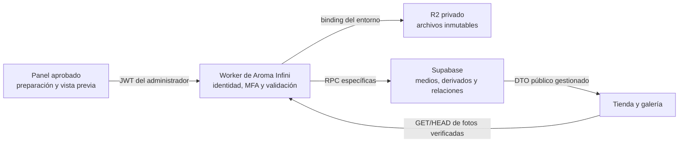

# Aroma Infini — Auditoría y plan de integración con R2

29 de octubre de 2026. **Plan aprobado por el usuario; integración de fotografías de productos implementada en desarrollo.** Estado y pruebas actuales en [R2_IMPLEMENTATION.md](R2_IMPLEMENTATION.md). El diagnóstico siguiente conserva la situación inicial como referencia; sus frases «todavía no» corresponden a la auditoría previa.

Se revisaron los Repomix `ECCOMERCE.xml` y `Bakemehappy.xml`, junto con la fuente actual de Aroma Infini. Los archivos de referencia se trataron como evidencia de código; no se ejecutaron sus scripts ni se copiaron credenciales, buckets o configuraciones privadas.

## 1. Resultado de la auditoría

| Área                     | Estado comprobado                                                                                                                                                             |
| ------------------------ | ----------------------------------------------------------------------------------------------------------------------------------------------------------------------------- |
| Catálogo y permisos      | Supabase contiene las ocho migraciones locales, incluidas las RPC administrativas con MFA y conflictos HTTP 409. El historial se consultó sin aplicar cambios.                |
| Modelo de fotografías    | Existen `app.media_assets`, `app.product_images` y `products.olfactory_media_id`. Se reutilizarán sus UUID, relaciones y reglas.                                              |
| Subida actual            | El navegador prepara WebP y vistas previas. El adaptador remoto rechaza correctamente los archivos `data:`/`blob:` al guardar: todavía no existe almacenamiento R2.           |
| Interfaz                 | Ya permite selección múltiple, cinco posiciones para perfumes, cuatro comerciales para complementos, reordenamiento, reemplazo, eliminación y guardar/continuar. Se conserva. |
| Publicación              | Requiere portada verificada y las condiciones vigentes de marca, precio y stock. Completar las cinco fotos no es un requisito adicional para publicar.                        |
| Worker                   | Sirve el frontend y rutas SEO. Actualmente rechaza métodos distintos de GET/HEAD y no tiene bindings R2 ni endpoints de archivos.                                             |
| Configuración Cloudflare | Wrangler 4.147.0 instalado. `whoami --json` no pudo autorizar la consulta: falta completar el login. No se inspeccionaron buckets remotos.                                    |
| Home                     | Solo Complementos y marca destacada son ajustes remotos. Textos, fotografías, carrusel y cuestionario editorial siguen locales.                                               |

La comparación de los archivos centrales del XML de Aroma con sus originales confirmó su coincidencia normalizando saltos de línea. Las decisiones de implementación deberán seguir la fuente actual si cambia después de esta auditoría.

### Incompatibilidades que hay que resolver

1. **Clave almacenada y URL visible son datos distintos.** `media_assets.object_key` prohíbe URLs y admite claves relativas R2. Sin embargo, los DTO actuales devuelven esa clave directamente como imagen; el lector público la rechazaría y el resolvedor podría interpretarla como una fotografía local. Se conservará la clave en SQL y se entregarán URLs gestionadas junto a identificadores y derivados verificados, tanto al panel como a la tienda.
2. **No basta cambiar `prepare()` por un PUT.** Actualmente un lote de fotos se prepara completo antes de aplicarlo al borrador. Si la quinta falla después de subir cuatro, hacen falta operaciones rastreables y recuperación de archivos sin asociación.
3. **Verificar MIME o primeros bytes no basta.** El servidor necesita decodificar la imagen completa, comprobar dimensiones y limitar recursos. La validación del navegador aporta una respuesta rápida, pero no autoriza el archivo.
4. **Responsive para subidas aún no existe.** Los derivados locales están catalogados; una URL remota no tiene variantes conocidas. Se registrarán exclusivamente tamaños creados y comprobados, sin inventar nombres ni ampliar imágenes pequeñas.
5. **Home todavía espera data URLs.** Sus normalizadores y validadores descartarían URLs R2. El contrato y la persistencia del Home se adaptarán conjuntamente después de validar productos.
6. **Rutas de producto desplegadas.** El Worker todavía consulta una lista estática para distinguir algunas fichas existentes de URLs desconocidas. Antes de dar por validado el flujo desplegado se comprobará la respuesta HTTP de productos remotos y sus recargas, sin activar indexación ni cambiar el diseño.

## 2. Qué aprovechar de Bake Me Happy

Se estudiaron los diez archivos solicitados y, adicionalmente, su configuración de Wrangler y el helper de versionado de activos.

| Práctica de referencia                              | Adaptación a Aroma Infini                                                                                                                   |
| --------------------------------------------------- | ------------------------------------------------------------------------------------------------------------------------------------------- |
| Preparación de variantes con Sharp y sin ampliación | Reutilizar los criterios para recursos estáticos. Las subidas del panel se procesan durante su operación, sin depender de un build.         |
| Anchos y `sizes` centralizados                      | Mantener perfiles propios de producto, imagen olfativa, categoría, Hero y recomendador. No copiar tamaños o reglas de tres fotos de tortas. |
| Hashes, concurrencia acotada y errores explícitos   | Evitar reintentos duplicados y conservar los archivos preparados cuando falle una parte.                                                    |
| Binding R2 en servidor                              | Acceder mediante el Worker, sin credenciales S3 en React.                                                                                   |
| UUID, cabeceras, streaming y caché                  | Usar claves nuevas e inmutables, tipos comprobados, ETag y respuestas administrativas sin caché.                                            |
| Separación de archivos temporales                   | Mantenerlos privados, con vencimiento independiente de las fotografías permanentes.                                                         |

No se trasladarán:

- La poda del manifiesto estático a fotografías dinámicas. El sync de referencia puede sobrescribir y borrar antes de terminar el build; revertir el despliegue no recupera esos archivos.
- La autorización basada únicamente en `Origin`. El upload de referencia no verifica Supabase, membresía administrativa ni MFA.
- Sus enlaces privados de 24 horas como referencias de producto.
- Sus claves estables sobrescritas con `?v=` para fotos del panel. Cada reemplazo tendrá otra identidad.
- El fallback de un archivo dinámico a una foto local de muestra.
- El bucket compartido entre producción y preview de la referencia, ni ninguno de sus secretos o dominios.

## 3. Arquitectura propuesta

Se ampliará el Worker existente mediante módulos de medios. No se incorporarán Pages Functions ni otro catálogo de archivos paralelo.

### Dos buckets, separados por entorno

Nombres propuestos, todavía no creados:

| Entorno    | Bucket                    | Acceso                                                                |
| ---------- | ------------------------- | --------------------------------------------------------------------- |
| Desarrollo | `aroma-infini-media-dev`  | Privado; únicamente el Worker de desarrollo y operadores autorizados. |
| Producción | `aroma-infini-media-prod` | Privado; únicamente el Worker de producción y operadores autorizados. |

Los nombres se comprobarán en la cuenta elegida. Los bindings de staging y producción nunca apuntarán al mismo bucket. La base de producción también deberá ser independiente de `aroma-infini-dev`.

Dentro de cada bucket se distinguirán claves gestionadas:

- `public/dynamic/…`: fotografías y derivados comerciales verificados, con UUID y hash/versionado.
- `staging/…`: archivos en proceso de carga o reconciliación, sin lectura anónima.
- `static/…`: reservado para una eventual copia verificada de recursos del repositorio; ningún sync podrá operar sobre `public/dynamic/`.
- `private/…`: reservado para un futuro uso privado confirmado; no se crea ahora un gestor de documentos ni se cargan datos personales.

**El bucket completo seguirá privado.** La lectura pública se hará mediante rutas limitadas del Worker para fotografías verificadas. Una carpeta llamada `private/` no sería una medida de seguridad si se hiciera público todo el bucket.

Al disponer del dominio definitivo, se podrá asociar `media.<dominio>` al Worker de entrega. Esto conserva el aislamiento de temporales. No se utilizará un dominio público directo del bucket que exponga todos sus prefijos, ni `r2.dev` como solución final de producción.

## 4. Carga segura y fallos parciales

Flujo propuesto por archivo:

1. Preparar la vista previa y los binarios localmente, conservando la experiencia de selección múltiple actual.
2. El Worker verifica el JWT con Supabase Auth y consulta el actor: mismo UUID, membresía activa y AAL2. El entorno y el bucket proceden de configuración del servidor.
3. Reservar una operación idempotente y un activo `pending` antes de escribir objetos. No aceptar un propietario, bucket, URL de destino o clave de objeto elegidos libremente por el navegador.
4. Validar límites de bytes, formato, dimensiones, píxeles y decodificación completa; comprobar cada derivado de manera secuencial y acotada.
5. Guardar objetos nuevos y verificar su existencia y metadatos. Calcular hashes en servidor; los datos enviados por el navegador no acreditan el contenido.
6. Confirmar el activo y sus derivados mediante una RPC específica exclusiva del servidor. Solo entonces puede utilizarse como referencia guardable.
7. Asociar las fotos al producto mediante el comando transaccional con su versión esperada. Mantener separada la imagen olfativa y sincronizada la portada con la primera posición de la galería.

Una confirmación de archivo almacenado no equivale a publicar el producto. Continúan aplicándose las reglas comerciales existentes.

### Autoridad y límites

- `Origin` y CORS serán controles adicionales; no sustituirán JWT, permisos o MFA.
- La verificación y confirmación de medios usarán una credencial Supabase exclusivamente de servidor, almacenada como secreto de Cloudflare. Se llamarán RPC concretas; no habrá proxy de SQL o CRUD genérico.
- El navegador no tendrá permiso para marcar `verified_at`, dimensiones, hash o estado `ready`. El ejecutor SQL de medios tendrá permisos acotados y no será propietario de las tablas ni tendrá `BYPASSRLS`.
- La confirmación volverá a comprobar la membresía vigente y la operación vinculada al actor verificado por el Worker. Ningún UUID recibido del body otorgará identidad.
- Se limitarán solicitudes por administrador y ráfagas de solicitudes. Los contadores de admisión no dependerán de un `Map` efímero del Worker.
- Como punto de partida se propone un máximo de dos subidas simultáneas del cliente y hasta cinco fotografías por lote visual. Los límites de bytes, píxeles, CPU y frecuencia se cerrarán tras medir los perfiles reales y las pruebas de 10/50 productos, antes de habilitar cargas remotas.

### Reintentos y limpieza

- Si falla R2, no marcar el activo como listo ni cambiar la ficha guardada.
- Si falla SQL después de guardar archivos, conservar la operación `pending`; el reintento comprobará sus objetos en lugar de crear otra copia.
- Repetir la misma operación con otro contenido se rechazará. La identidad no permitirá sobrescribir un archivo ya publicado.
- Si el producto recibe un conflicto HTTP 409 después de subir fotos, conservar el borrador y las referencias verificadas. No borrar inmediatamente esas fotografías.
- Quitar una foto del formulario elimina su asociación al guardar; no constituye por sí solo una orden de borrado físico.
- Propuesta de recuperación: siete días para archivos verificados que queden sin referencias; temporales incompletos, 24 horas. Son valores técnicos propuestos, ajustables antes de activar la política.
- Antes de eliminar físicamente, una operación SQL debe reclamar el activo sin referencias y bloquear su asociación simultánea. Asociación y limpieza bloquearán la misma fila, evitando la carrera entre comprobar y borrar.
- Un activo reclamado para borrado no volverá a ser asociable por el mero vencimiento de la concesión. Los reintentos retomarán el mismo estado de borrado y lo reconciliarán; así un borrado tardío no podrá eliminar un archivo reasociado.
- El proceso de limpieza borrará únicamente las claves registradas del activo reclamado y sus derivados. Se confirmará SQL después; fallos y concesiones vencidas se reconciliarán de forma idempotente.
- Lifecycle podrá expirar temporales cuyo uso esté controlado. No se configurará una caducidad por edad sobre fotografías permanentes ni una poda del bucket durante el despliegue.

## 5. Modelo de datos y URLs

Se mantienen `media_assets`, `product_images` y `olfactory_media_id`. Las migraciones nuevas propuestas añadirán:

1. Campos de tamaño real, hash, responsable, identificador de operación y fechas de recuperación/reconciliación al activo existente. Durante `pending`, los metadatos todavía desconocidos podrán ser nulos; nuevas restricciones exigirán dimensiones, formato, tamaño y hash verificados al pasar a `ready`. No se rellenarán los actuales campos obligatorios con dimensiones ficticias para reservar una carga.
2. Una tabla hija de derivados realmente generados: activo, ancho/alto, MIME, tamaño, hash y clave única. No es un segundo catálogo ni un snapshot del panel.
3. RPC de reserva/consulta, confirmación exclusiva del servidor y reclamación/finalización de limpieza, con permisos y pruebas negativas.
4. Resolución de medios gestionados en DTO públicos y administrativos. El guardado utilizará identificadores verificados; una URL HTTPS cualquiera no podrá registrar un archivo como existente.
5. Posteriormente, relaciones y contenido específico del Home. Sus fotografías también serán FK a los mismos medios.

Ejemplo conceptual de referencia pública: `/media/public/<activo>/<version>/<ancho>.webp`. El servidor resolverá exclusivamente claves y variantes registradas. No habrá redirecciones a hosts arbitrarios ni parámetros de transformaciones ilimitadas.

La variable existente `VITE_MEDIA_BASE_URL` no se activará globalmente para fingir que todos los archivos locales ya fueron migrados. Los recursos estáticos conservarán su origen hasta comprobar su copia exacta. Las fotografías dinámicas no dependerán de archivos en Git.

## 6. Calidad, formatos y caché

Se conservarán los perfiles y mínimos actuales:

| Uso                          | Proporción | Área útil mínima actual | Mayor ancho preparado actualmente |
| ---------------------------- | ---------- | ----------------------- | --------------------------------- |
| Galería comercial            | 4:5        | 800 × 1000              | Hasta 1600, sin ampliar           |
| Imagen olfativa              | 4:5        | 960 × 1200              | Hasta 1600, sin ampliar           |
| Categorías                   | 4:5        | 800 × 1000              | Hasta 1600, sin ampliar           |
| Hero y Finder desktop        | 16:9       | 1536 × 864              | 1536                              |
| Hero y Finder móvil          | 2:3        | 780 × 1170              | 780                               |
| Opciones visuales del Finder | 1:1        | 480 × 480               | 480                               |

El panel podrá seguir aceptando JPG, PNG, WebP y AVIF para su preparación. La propuesta inicial es subir WebP preparado, con variantes limitadas por uso, y decodificarlo completamente en el Worker con un codec WebAssembly empaquetado. Así no hace falta incorporar decodificadores de todos los formatos originales al servidor ni contratar transformaciones externas.

Se probará el codec en el runtime real de Workers antes de aprobar sus límites de producción. La optimización en el navegador no reemplaza la verificación del servidor. No se copiará `sharp` como si su módulo nativo de Node funcionara directamente dentro de Workers.

Se generarán derivados inferiores al original —por ejemplo, 480/960/1600 donde correspondan y existan— conservando el mayor tamaño útil. Si una fuente solo permite 800 px, no se fabricará una variante ampliada a 960. La respuesta incluirá el manifiesto de archivos verificados que consumen `srcset` y `sizes`.

Las imágenes secundarias seguirán usando lazy loading y las críticas conservarán su prioridad actual. Cada sustitución tendrá otro UUID/versionado. Las respuestas públicas podrán llevar caché larga e inmutable, ETag y `nosniff`; las respuestas de administración y cargas usarán `no-store`. La entrega de vídeo se probará con GET/HEAD y solicitudes Range cuando se incorpore.

No se habilitarán Cloudflare Images, Stream ni transformaciones de pago automáticamente. R2 y Workers tienen sus propias condiciones de uso y facturación: no se promete coste cero. Cualquier necesidad de otro plan o servicio se explicará antes de activarlo.

## 7. Implementación por etapas verificables

1. **Aprobar este plan y autorizar Cloudflare.** Comprobar cuenta y habilitación de R2. Crear inicialmente desarrollo; reservar producción hasta su configuración independiente.
2. **Preparación local.** Worker, perfiles, verificación WebP, contratos, migraciones y pruebas con almacenamiento emulado. Sin cambiar el diseño.
3. **Integración real de desarrollo.** Binding al bucket nuevo, secretos y RPC revisadas. Completar un perfume con sus cinco fotos y un complemento. Probar lectura desde otra sesión/dispositivo.
4. **Robustez y volumen.** Diez/cincuenta productos temporales identificados, fallos parciales, conflictos, reintentos, referencias y limpieza. No transformar estas fixtures en catálogo comercial.
5. **Home.** Conectar sus relaciones y contenido persistente después del flujo de productos. Mantener imágenes desktop/móvil y, para vídeo, derivados reales del mismo material. R2 no transcodifica automáticamente un MP4.
6. **Preparación de producción.** Bucket, Worker, proyecto Supabase, secretos y dominio propios del entorno; revisar caché, cabeceras, CORS, coste, restauración y pruebas reales antes de publicar.

## 8. Configuración que realiza el propietario

Después de aprobar el plan:

1. Entrar a la cuenta de Cloudflare destinada a Aroma Infini. Puede ser la misma cuenta propietaria de otros proyectos, pero los recursos, bindings y secretos de la aplicación serán nuevos e independientes.
2. Revisar R2 Object Storage y, si solicita activar el servicio o aceptar facturación, hacerlo personalmente después de revisar las condiciones. Esta auditoría no realizó esa activación.
3. En PowerShell, desde la carpeta del proyecto, ejecutar `npx.cmd wrangler login`, completar la autorización en el navegador y avisar cuando finalice. No compartir tokens en el chat.
4. Confirmar el entorno de desarrollo y los nombres nuevos antes de su creación. La disponibilidad y la lista de recursos solo podrán verificarse con la sesión autorizada.
5. Para secretos del Worker, utilizar el mecanismo protegido de Cloudflare cuando estén definidos los endpoints; no pegarlos en `.env.example`, variables `VITE_`, documentos ni conversación. El binding R2 evita necesitar una clave S3 en React.
6. Proporcionar el dominio definitivo cuando exista, para preparar la entrega pública de producción. No hace falta un dominio definitivo para empezar las pruebas aisladas de desarrollo.

## 9. Validación prevista y estado de entrega

Se probarán los flujos solicitados: cinco fotos de perfume, complemento, lotes de 10/50 productos, galerías incompletas, reordenamiento, sustitución, eliminación, pérdida de conexión, archivos inválidos o enormes, duplicados idempotentes y edición concurrente.

Las pruebas de seguridad incluirán visitantes, clientes, administrador AAL1, AAL2, membresía revocada, referencias inventadas, claves ajenas, formatos manipulados, dimensiones excesivas y lectura de prefijos privados. Las de reconciliación incluirán fallo SQL después del PUT, fallo de eliminación R2 y asociación concurrente con la limpieza.

Se verificará el objeto real mediante R2 y HTTP, persistencia tras recarga, otra sesión/dispositivo, caché de sustituciones, `srcset` existente, referencias SQL y ausencia de huérfanos no gestionados. Capturas en 1920×1080, 1440×900, 1366×768, 768×1024 y 390×844; typecheck, lint, build y regresiones correspondientes.

**Resultado histórico de la auditoría inicial:** el plan se presentó antes de crear recursos. Tras la aprobación se conectó el flujo de productos al bucket privado de desarrollo y se desplegó el Worker. La continuación del punto 5 conecta el [Home remoto](R2_HOME_IMPLEMENTATION.md), con contenido versionado, asociaciones protegidas y vídeo principal/móvil. La [entrega de implementación](R2_IMPLEMENTATION.md) y su continuación distinguen las pruebas reales y aisladas. El punto 6, habilitación de producción, permanece pendiente de sus recursos y dominio propios.

## Fuentes y evidencia

- Código de referencia: los diez archivos Bake Me Happy indicados en el encargo. Informe detallado seguro: `artifacts/r2-audit-2026-10-29/bake-reference.md`.
- Fuente actual: servicios de activos/fotografías, formularios, Worker, contratos, migraciones y [Fase 4](SUPABASE_PHASE_4.md).
- Historial remoto consultado: `artifacts/r2-audit-2026-10-29/migrations.stdout.log`, ocho versiones locales/remotas coincidentes.
- [Workers: bindings R2](https://developers.cloudflare.com/r2/api/workers/workers-api-usage/).
- [Buckets públicos y alcance de dominios](https://developers.cloudflare.com/r2/buckets/public-buckets/).
- [Lifecycle: alcance y vencimiento](https://developers.cloudflare.com/r2/buckets/object-lifecycles/).
- [Buenas prácticas Workers](https://developers.cloudflare.com/workers/best-practices/workers-best-practices/).
- [WebAssembly en Workers](https://developers.cloudflare.com/workers/runtime-apis/webassembly/) y [codec jSquash](https://github.com/jamsinclair/jSquash).
- [Wrangler: autorización y consulta de sesión](https://developers.cloudflare.com/workers/wrangler/commands/general/).
- [Condiciones de facturación R2](https://developers.cloudflare.com/r2/pricing/) y [Workers](https://developers.cloudflare.com/workers/platform/pricing/).
