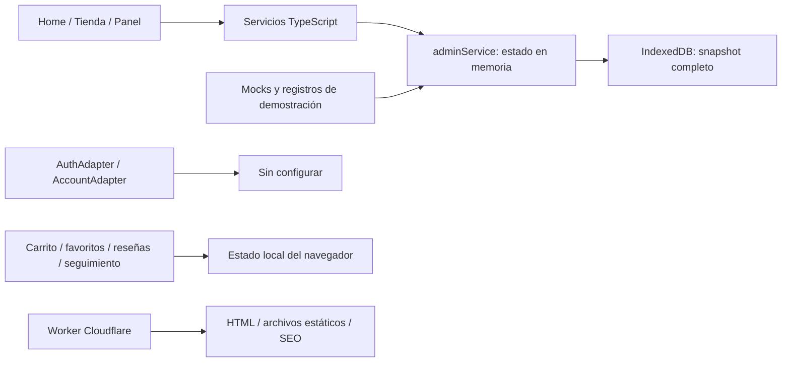
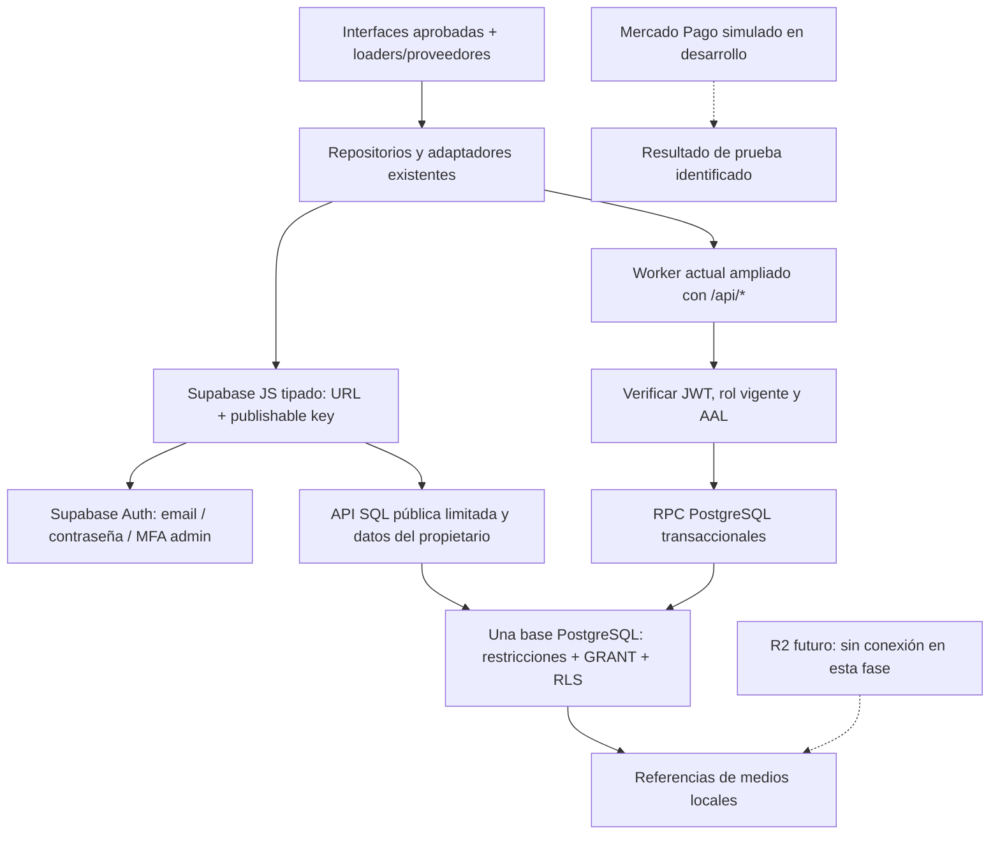

# Supabase — Fase 1: auditoría y arquitectura

**Informe histórico de la primera etapa.** El avance posterior y las migraciones aplicadas al proyecto de desarrollo se documentan en [SUPABASE_PHASE_2.md](SUPABASE_PHASE_2.md). Los estados «pendiente» de este informe corresponden al cierre de la auditoría inicial.

Auditoría iniciada el 26 y cerrada el 27 de octubre de 2026. Proyecto objetivo declarado por el cliente: `aroma-infini-dev`.

**Estado: primera fase preparada; arquitectura y esquema propuestos, sin migraciones aplicadas.** Esta entrega cumple la instrucción final del documento del cliente: presentar esquema y estrategia de permisos antes de crear la base. No representa una integración terminada ni una certificación de producción.

Se conservan diseño, funcionalidades, archivos subidos y persistencia local. No se instaló el SDK, modificó el frontend, creó una cuenta, escribió en Supabase, conectó R2 ni desplegó Cloudflare. El cliente confirmó posteriormente que **Mercado Pago debe continuar simulado**; esa decisión se incorpora a la secuencia de implementación.

## 1. Comprobaciones y límites

| Área                         | Resultado comprobado                                                                                                                                                                                                                                                                                             |
| ---------------------------- | ---------------------------------------------------------------------------------------------------------------------------------------------------------------------------------------------------------------------------------------------------------------------------------------------------------------- |
| Aplicación                   | React 19, React Router 7, TypeScript estricto, Vite 8; Tailwind y CSS del proyecto. Rutas con loaders y módulos lazy. No hace falta reconstruir el frontend.                                                                                                                                                     |
| Supabase SDK                 | `package.json` no contiene `@supabase/supabase-js`. No hay cliente remoto ni migraciones anteriores en el repositorio.                                                                                                                                                                                           |
| Configuración local          | Existe URL y clave **publicable** en `.env.example`. No se encontró un archivo `.env.local` ni otro `.env` de runtime en la raíz. Vite no carga `.env.example` automáticamente. No se duplican esos valores en esta documentación.                                                                               |
| Comprobación remota limitada | Solo GET de configuración pública: Auth respondió 200, correo habilitado, registro habilitado, confirmación de email requerida y Google deshabilitado. No se registraron usuarios ni enviaron correos.                                                                                                           |
| Inventario remoto            | El descubrimiento OpenAPI `/rest/v1/` respondió 401, `Secret API key required`. No se solicitó una clave privilegiada por chat ni se intentó eludirlo. No permite concluir si existen tablas ni si sus GRANT/RLS son correctos.                                                                                  |
| Configuración del Dashboard  | Nombre del proyecto, RLS automático y exposición automática desactivada son información proporcionada por el cliente. No se pudo verificar PostgreSQL, tablas, políticas, grants, MFA, SMTP ni URLs autorizadas con la consulta pública.                                                                         |
| Herramientas SQL             | No se encontró CLI Supabase, `psql` ni Docker en PATH. No se ejecutaron pruebas SQL ni se generaron tipos desde una base no inspeccionada.                                                                                                                                                                       |
| Git                          | HEAD inicial `5487e8b05f149105f460b88d66ac092b878919f3`; árbol con numerosos cambios previos y archivos sin seguimiento. Se registraron estado y diff-stat en artifacts; no se descartaron, staged ni confirmaron cambios ajenos. Ese registro no sustituye un respaldo del árbol sin confirmar ni de IndexedDB. |

Evidencia remota sin claves: `artifacts/supabase-phase-1-2026-10-26/public-probe.json`. El 401 de OpenAPI **no** se resuelve incorporando una Secret key al navegador. El [anuncio oficial de Supabase](https://github.com/orgs/supabase/discussions/42949) restringe ese descubrimiento, sin impedir el uso normal de los recursos permitidos por el SDK público. No prueba por sí solo que las tablas estén protegidas.

## 2. Arquitectura que existe hoy

| Frontera                | Evidencia y consecuencia                                                                                                                                                                                                                                                                                                               |
| ----------------------- | -------------------------------------------------------------------------------------------------------------------------------------------------------------------------------------------------------------------------------------------------------------------------------------------------------------------------------------- |
| Arranque y snapshot     | `src/main.tsx:23` hidrata todo el estado administrativo antes de inicializar auth. En remoto no puede convertirse en una descarga pública de clientes y pedidos.                                                                                                                                                                       |
| Fuente de catálogo      | `storefront-repository.ts:50` transforma el snapshot de `adminService`. Panel y tienda coinciden en ese navegador, no entre dispositivos. `peekSnapshot()` no equivale a una consulta remota síncrona.                                                                                                                                 |
| Persistencia            | `admin-persistence.ts` conserva `snapshot/current` en IndexedDB. `commit()` publica en memoria y programa la escritura. `useAdminSave()` espera `flush()`, pero el cambio ya está aplicado localmente.                                                                                                                                 |
| Contratos reutilizables | `types/catalog.ts`, `types/admin.ts`, `types/home.ts`, `types/shipping.ts`, `types/commerce.ts`, `types/account.ts` y `types/auth.ts`. Se adaptarán filas/DTO a estos contratos; no se crea otro catálogo de modelos incompatible.                                                                                                     |
| Catálogo y variantes    | Un producto perfume/complemento, variantes con precio en céntimos y stock, hasta cuatro fotos comerciales y una imagen olfativa independiente. SKU de producto automático de cinco dígitos; SKU comercial de variante opcional e independiente.                                                                                        |
| Publicación             | Activo, marca activa cuando corresponde, imagen principal y stock en variante activa. Agotarse desactiva el producto; reponer stock no lo reactiva automáticamente. Mantener esas reglas en servidor.                                                                                                                                  |
| Ofertas y cupones       | Oferta única por producto, porcentaje entero1–99 o fijo en céntimos por presentación. Cupones separados: porcentaje decimal hasta100 o fijo expresado en soles en el contrato actual, mínimo, límite y vigencia. El checkout no combina cupones con productos en oferta. La validación del navegador es ayuda, no autoridad de compra. |
| Excel y marcas          | Ya existen preview, validación y confirmación. Excel sin URLs de fotos, máximo 5 MB/1000 filas; crea borradores pendientes de fotografías. Las marcas aceptan listas con normalización y detección de duplicados.                                                                                                                      |
| Medios                  | Los preparadores de imágenes/video devuelven data URIs. Los validadores del Home también los esperan. Cambiar únicamente la persistencia introduciría binarios/base64 en PostgreSQL y no resolvería las subidas.                                                                                                                       |
| Autenticación           | Adaptadores no configurados; guards y comprobaciones de propietario en React ya existen. `validSession()` valida forma y caducidad, no sustituye verificación JWT, autorización SQL ni MFA.                                                                                                                                            |
| Cuenta                  | Perfil y pedidos esperan repositorio async por usuario; la UI actual administra una dirección. Favoritos continúan en un store local sin propietario y reseñas proceden de fixtures + navegador.                                                                                                                                       |
| Checkout                | `simulatePayment()` y `persistDemoCheckout()` no cobran. La simulación local registra `approved`, descuenta stock y contabiliza cupones en IndexedDB. Ese resultado no debe autorizar cobros ni inventario reales.                                                                                                                     |
| Pedidos                 | Estados reales del modelo: `received`, `preparing`, `shipped`, `delivered`; pagos separados `pending`, `approved`, `rejected`, `refunded`. Cambios individuales/masivos y PDF existentes son reutilizables. Lotes retirados: no se reconstruyen.                                                                                       |
| Cloudflare              | `worker/seo-router.ts` solo acepta GET/HEAD y sirve ASSETS/SEO. No hay API comercial ni proveedor de pagos. `wrangler.jsonc` apunta a `dist` y dispone de staging.                                                                                                                                                                     |
| SEO                     | Rutas indexables y prerender parten de archivos de build. Un producto remoto nuevo podría renderizar en React y seguir devolviendo 404 o metadatos antiguos en Worker. Hace falta conectar también la publicación pública y el sitemap.                                                                                                |

Auditorías detalladas con referencias: `artifacts/supabase-phase-1-2026-10-26/{catalog,auth,orders}-audit.md`. Son lecturas de código y contextos de prueba, no un inventario del navegador personal del cliente.

## 3. Arquitectura propuesta

### Responsabilidades

- **Presentación:** conservar componentes, layouts, selector de acceso, formularios, modales, loading/empty/error y responsive. Errores de campo debajo del input; errores generales en modal. Mostrar éxito únicamente después de confirmar la operación.
- **Estado frontend:** caché de respuestas y borradores; carrito de invitado con IDs/cantidades. No autoridad de permisos, precios finales, pago ni inventario. Cerrar sesión invalida datos privados del usuario anterior.
- **Acceso a datos:** reemplazar las implementaciones existentes, no mantener dos fuentes comerciales activas. El modo remoto no recurre a mocks/IndexedDB si falla la red; informa error y ofrece reintento. La caché no es una segunda persistencia comercial.
- **Supabase Auth:** un cliente SDK de SPA, con confirmación/callback PKCE, persistencia/renovación del SDK y eventos. No crear otro sistema de tokens. La SPA directa no promete cookies HttpOnly; un BFF sería otra decisión arquitectónica, no un añadido implícito.
- **Worker existente:** orquestación de comandos privilegiados, verificación del bearer, rol vigente/AAL, límites de cuerpo, idempotencia y errores seguros. Añadir `/api/*` al Worker-first y despachar sus métodos antes de la restricción GET/HEAD del SEO. Sin Edge Functions duplicadas ni conexión SQL directa/Hyperdrive para llamadas HTTPS a Supabase.
- **PostgreSQL:** fuente única de datos y autoridad transaccional para SKU, unicidad, precios, cupones, inventario, estados y snapshots históricos. El frontend puede anticipar una validación; la transacción decide. El Worker no mantiene otra fórmula autoritativa de precios.
- **Recursos:** PostgreSQL guarda metadatos/referencias; archivos actuales siguen locales. No Storage Supabase ni R2 hasta su etapa autorizada.

El esquema y la matriz exacta de acceso propuestos están en [SUPABASE_SCHEMA_PLAN.md](SUPABASE_SCHEMA_PLAN.md). La propuesta utiliza un esquema API expuesto explícitamente y tablas operativas no expuestas directamente. Esto reduce la superficie de escritura accidental y exige GRANT/RLS incluso en las tablas internas; no se confía solo en ocultar schemas.

## 4. Integración por fronteras, sin rehacer pantallas

| Frontera actual                                             | Sustitución necesaria                                                                                                                                                                              |
| ----------------------------------------------------------- | -------------------------------------------------------------------------------------------------------------------------------------------------------------------------------------------------- |
| `auth-adapter.ts`, `auth-service.ts`                        | Implementación SDK, errores mapeados, identidad verificada, roles protegidos y AAL. Conservar `safeAuthReturn`, guards y separación recovery/account.                                              |
| `account-adapter.ts`, `AccountProvider`                     | Lecturas/escrituras del propietario. El correo canónico proviene de Auth; cambiarlo requiere confirmación de Auth, no UPDATE de perfil.                                                            |
| `storefront-repository.ts`, `catalog/home/shipping-service` | Consultas públicas acotadas/paginadas y caché pública. Pasar galería, marca, configuración y recomendaciones por loaders/proveedores al retirar lecturas síncronas.                                |
| `admin-service.ts`, `useAdminSave`                          | Operaciones async granulares con versión/idempotencia. Actualizar caché después del commit remoto. Un timeout requiere comprobar/reintentar la misma operación, no insertar otra vez.              |
| `FavoritesProvider`                                         | Favoritos autenticados por `auth.uid()` y favoritos invitados separados. No mezclar identidades al entrar/salir; cualquier fusión deberá ser explícita y deduplicada.                              |
| `review-service.ts`                                         | Opiniones reales independientes del formulario de producto. No importar 50 opiniones de fixture ni afirmar compra verificada sin prueba. Falta acordar moderación.                                 |
| `checkout-service.ts`                                       | Cotización autoritativa y creación idempotente. Simulación MP explícita de desarrollo según instrucción del cliente; sin proveedor externo ni pago real aprobado por el navegador.                 |
| `order-status-service.ts` / seguimiento                     | Consulta por propietario o prueba de posesión de invitado; nunca descargar todos los pedidos al público ni protegerlos solo con referencia.                                                        |
| PDF                                                         | Mantener generador en navegador y selección congelada; cargar previamente solo los pedidos autorizados, sin URL pública a documentos con datos personales.                                         |
| Publicación y SEO                                           | Resolver existencia y metadatos desde la misma fuente publicada; preparar respuesta Worker para nuevos slugs y sitemap con invalidación. Mantener noindex hasta aprobar catálogo y dominio reales. |

## 5. Mercado Pago simulado y operación real posterior

La aclaración del cliente prevalece: **no se conecta Mercado Pago en esta integración inicial**. La simulación actual se conserva durante la preparación y deberá seguir identificándose como prueba al conectar repositorios remotos.

- Un resultado `approved` de JavaScript no se convierte en un pago real ni en permiso para descontar inventario real.
- Si se persisten resultados simulados en desarrollo, llevarán un modo de prueba inequívoco, aceptado por configuración del servidor de desarrollo, y separado de estados/transacciones financieros reales. Un flag `VITE_` por sí solo no habilita ese permiso.
- Las fixtures no se importan a la base comercial como clientes, pedidos ni ventas reales. Producción no debe aceptar el comando de simulación, aunque se falsifique una solicitud HTTP.
- La política de reservas y el plazo de vencimiento **no han sido confirmados**. No se inventan 15/30 minutos, se envían pedidos pagados ficticios ni se activa un cron de liberación por suposición.
- Comprobar stock al crear un pendiente, sin reservarlo ni consumirlo, no garantiza la última unidad. El checkout comercial requerirá definir ese punto transaccional antes de habilitar ventas reales; la simulación puede continuar aislada sin consumir stock real.
- Cuando corresponda el pago real: evento verificado del proveedor, unicidad por evento/transacción, actualización y consumo de inventario/cupón una sola vez dentro de transacción. Ningún secreto de Mercado Pago se necesita ahora.

## 6. Datos y fotografías: transición segura

1. No migrar automáticamente `AdminState`, los 15 productos de muestra, los pedidos demo ni reseñas ficticias. Primero inventariar el catálogo y la configuración elegidos por el negocio, sin borrar IndexedDB.
2. Identificar por separado datos comerciales confirmados, borradores, fixtures y fotografías subidas. No afirmar que todo lo guardado en un navegador sea prueba ni que todo sea real.
3. Preservar SKU/slug revisados y registrar un mapa de IDs antiguos → UUID. Un UUID de Auth nunca se obtiene comparando correos de pedidos invitados.
4. Registrar referencias de los archivos públicos existentes. Rechazar data URI/base64 en el guardado remoto de medios.
5. Hasta R2, archivos nuevos pueden conservarse como borrador/vista previa local, sin anunciar subida o publicación permanente. Cambios de texto con medios todavía pendientes no deben sobrescribir fotos ya publicadas ni perder el borrador.
6. Con R2 en una etapa posterior, la misma interfaz usará un upload autorizado por Worker y guardará la clave del objeto; el administrador seguirá sin introducir URLs. La imagen olfativa sigue independiente de las cuatro comerciales.

Hay una diferencia que debe mantenerse explícita: el formulario admite **hasta cuatro fotos**, pero hoy la publicación exige una principal, no necesariamente cuatro. El esquema preserva esa regla existente; endurecerla requiere una decisión comercial.

## 7. Configuración para la etapa siguiente

| Lugar                  | Nombres / acción                                                                                              | Estado                                                                                                                                                                                                |
| ---------------------- | ------------------------------------------------------------------------------------------------------------- | ----------------------------------------------------------------------------------------------------------------------------------------------------------------------------------------------------- |
| Frontend de desarrollo | `VITE_SUPABASE_URL`, `VITE_SUPABASE_PUBLISHABLE_KEY`                                                          | Valores públicos ya facilitados en la plantilla; mover a configuración runtime local ignorada cuando se active el SDK. Mantener `.env.example` sin valores de proyecto al estandarizar configuración. |
| Cloudflare, no secreto | `SUPABASE_URL`, `SUPABASE_PUBLISHABLE_KEY`, origen permitido de la aplicación y modo de entorno               | Configurar cuando exista API Worker; no cambiar despliegue por esta auditoría.                                                                                                                        |
| Cloudflare, secreto    | `SUPABASE_SECRET_KEY` solo si una operación estrictamente servidor lo necesita                                | No requerida para operaciones normales con JWT del actor. No colocar en `VITE_`, JSON de configuración, Git o chat. Un secreto omite RLS: su uso requiere autorización y alcance explícitos.          |
| Migraciones            | CLI autenticada por el propietario, referencia del proyecto y conexión privilegiada por canal local seguro    | Pendiente. La publishable key no permite aplicar SQL ni generar un inventario completo. No enviar contraseña SQL ni token personal por chat.                                                          |
| Supabase Dashboard     | Lista de schemas expuestos, configuración de grants/RLS, versión PostgreSQL, callbacks, MFA y contraseña/SMTP | Ejecutar el preflight de solo lectura y verificar ajustes antes de DDL. No cambiar defaults a ciegas ni retirar permisos de objetos ajenos.                                                           |
| URLs                   | Desarrollo: origen local usado y `/auth/callback`; staging/producción: dominios HTTPS confirmados             | Falta confirmar dominio final y lista exacta. Conservar retornos internos seguros.                                                                                                                    |

La primera cuenta admin se autorizará por UUID verificado desde un entorno privilegiado, con registro de quién concede acceso; nunca por coincidencia de correo, metadata editable o registro público. Enrolar y verificar MFA antes de habilitar operaciones administrativas reales. La comprobación pública no verifica que MFA esté configurada.

## 8. Secuencia y puntos de control

| Etapa                      | Entrega / condición para avanzar                                                                                                                                                                                                                |
| -------------------------- | ----------------------------------------------------------------------------------------------------------------------------------------------------------------------------------------------------------------------------------------------- |
| 1. Auditoría, esta entrega | Mapa actual, arquitectura, esquema, permisos propuestos, límites y baseline. Sin DDL remoto.                                                                                                                                                    |
| 2. Base de datos           | Inspección privilegiada de solo lectura; migraciones nuevas en control de versiones y probadas localmente; restricciones, GRANT/RLS/RPC y pruebas negativas. Presentar impacto/diff antes de aplicar a dev; respaldar si ya existe información. |
| 3. Identidad               | SDK tipado, registro/confirmación/recuperación, roles, primer admin y MFA. Conservar las pantallas aprobadas. Pruebas con usuarios A/B/admin reales de desarrollo.                                                                              |
| 4. Catálogo y Home         | Repositorios remotos, SKU/concurrencia, precios/promociones, flags y referencias de medios; no fallback silencioso a catálogo ilustrativo.                                                                                                      |
| 5. Clientes y pedidos      | Propiedad, favoritos, direcciones, seguimiento y comandos de pedido. Simulación MP identificada; no pagos reales ni reservas inventadas.                                                                                                        |
| 6. Operaciones avanzadas   | Excel/marcas con resultados idempotentes, acciones masivas y PDF; conservar límites y selección actuales. Sin lotes.                                                                                                                            |
| 7. Validación y producción | SQL/RLS/concurrencia, E2E, responsive y revisiones de publicación. Proyecto Supabase de producción independiente, secretos/usuarios distintos, sin seed demo. R2/pagos/SMTP pendientes identificados antes de lanzar.                           |

Tipos `Database` se generarán desde el esquema **realmente aplicado** con CLI, no se escribirán a mano fingiendo haber introspectado tablas. La versión de `@supabase/supabase-js` se fijará al instalar una versión estable compatible, dejando lockfile reproducible. No se añaden ORM, Edge Functions ni proveedores paralelos por anticipado.

## 9. Plan de pruebas y resultados de esta fase

Los resultados ejecutados y las limitaciones están en `artifacts/supabase-phase-1-2026-10-26/validation.md`. Los tests actuales usan adaptadores de prueba y persistencia local: validan la línea base, **no prueban Supabase, RLS ni cobros reales**.

Para las fases siguientes se requieren:

- SQL/pgTAP con anon, cliente A/B, admin AAL1/AAL2 y rol revocado; sin lecturas cruzadas, UPDATE de propietario, elevación de rol ni escritura directa de pago/inventario.
- Dos compras concurrentes por la última unidad, cupones al límite, reintentos del mismo comando y evento duplicado. Resultado transaccional sin sobreventa ni doble consumo.
- Publicar/editar producto con variantes, ofertas y stock; SKU simultáneos únicos; Excel y marcas 5/20/50/100, duplicados y errores parciales documentados.
- Recuperación, confirmación, refresh y logout; no registro público admin, Google ausente, MFA exigida también al llamar la API directamente.
- Carrito y favoritos invitados preservados, favoritos por dueño, pedido invitado protegido sin enumeración, PDF solo selección autorizada.
- Capturas en 1920×1080, 1440×900, 1366×768, 768×1024 y 390×844, sin rediseño. Fallos remotos conservan borrador y no muestran éxitos ficticios.

## 10. Fuentes primarias consultadas

- [Claves públicas y secretos](https://supabase.com/docs/guides/getting-started/api-keys).
- [Seguridad Data API: GRANT, RLS y exposición](https://supabase.com/docs/guides/api/securing-your-api).
- [RLS y vistas](https://supabase.com/docs/guides/database/postgres/row-level-security).
- [Funciones PostgreSQL](https://supabase.com/docs/guides/database/functions).
- [Perfiles vinculados a Auth](https://supabase.com/docs/guides/auth/managing-user-data).
- [PKCE](https://supabase.com/docs/guides/auth/sessions/pkce-flow), [verificación de usuario](https://supabase.com/docs/reference/javascript/auth-getuser) y [MFA](https://supabase.com/docs/guides/auth/auth-mfa).
- [Migraciones](https://supabase.com/docs/guides/local-development/database-migrations), [tipos generados](https://supabase.com/docs/guides/api/rest/generating-types) y [pruebas de base](https://supabase.com/docs/guides/database/testing).
- [Restricción de acceso al descubrimiento OpenAPI](https://github.com/orgs/supabase/discussions/42949).
- [Buenas prácticas Workers](https://developers.cloudflare.com/workers/best-practices/workers-best-practices/).
