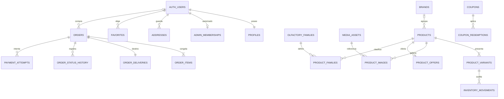

# Supabase — esquema y permisos propuestos

Propuesta iniciada el 26 y revisada el 27 de octubre de 2026. Complementa [SUPABASE_PHASE_1.md](SUPABASE_PHASE_1.md). **No es el esquema remoto inspeccionado ni una migración aplicada.** El inventario privilegiado del proyecto dev es requisito previo a cualquier DDL.

## Superficie de datos

Se propone exponer explícitamente `api` a PostgREST. `app` contendrá tablas operativas con RLS y `private` membresías/operaciones internas, fuera de la exposición Data API. No se cambiará la lista de schemas del Dashboard antes de inspeccionar los existentes. No se vuelcan snapshots en una tabla JSON genérica.

La frontera API dará DTO públicos, operaciones propias del cliente y comandos administrativos con autorización. Las tablas base no reciben CRUD directo del navegador. Las funciones privilegiadas no quedan protegidas automáticamente por tener RLS: tendrán comprobaciones de actor, pertenencia y AAL, permisos explícitos y tests específicos.

## Relaciones principales

Los nombres del diagrama representan entidades, no tablas ya creadas. El FK de `orders.user_id` admite NULL para invitados. El destino del pedido es un snapshot, no un enlace mutable a una dirección del perfil. La imagen olfativa usa un FK separado en producto y no participa en `product_images`.

## Tablas: catálogo y contenido

| Entidad propuesta                             | Campos/relaciones esenciales                                                                                                                                                                                          | Invariantes                                                                                                                                                                                                                                                                                                                                                                        |
| --------------------------------------------- | --------------------------------------------------------------------------------------------------------------------------------------------------------------------------------------------------------------------- | ---------------------------------------------------------------------------------------------------------------------------------------------------------------------------------------------------------------------------------------------------------------------------------------------------------------------------------------------------------------------------------- |
| `app.brands`                                  | UUID, nombre, clave de nombre normalizada, slug, activo, versión, fechas                                                                                                                                              | UNIQUE de nombre normalizado y slug; normalización calculada por operación confiable, no recibida sin validar del cliente. No sobrescribir por coincidencia.                                                                                                                                                                                                                       |
| `app.products`                                | UUID, legacy_id opcional, código SKU, slug, marca FK nullable, product_type, género, perfil editorial, descripciones, intensidad, ocasión, temporada, activo, ranking, umbral stock, `olfactory_media_id` FK, versión | Código 10000–99999 por asignación atómica de secuencia y UNIQUE; slug UNIQUE; marca exigida para perfume. Complemento sin datos olfativos/género. Intensidad nivel1–3 o NULL; etiqueta derivada. Campo de concentración retirado no se reconstruye.                                                                                                                                |
| `app.product_variants`                        | UUID, producto FK, legacy_id opcional, SKU comercial nullable, ml/etiqueta, clave de presentación, precio en céntimos, stock, activo, versión                                                                         | UNIQUE SKU normalizado cuando existe; UNIQUE(producto,presentación); precio no negativo en borrador, mayor que cero para variantes activas al publicar; stock entero no negativo. Excel conserva su requisito de precio positivo. Ml positivo para perfumes y NULL para complementos. Validación cruzada en función/trigger, no CHECK ficticio que consulte otra tabla.            |
| `app.olfactory_families`                      | código PK y etiqueta                                                                                                                                                                                                  | Solo ocho identificadores existentes: amaderado, floral, verde, ambar, citrico, aromatico, fresco, gourmand. Son datos de referencia, no clasificación inventada.                                                                                                                                                                                                                  |
| `app.product_olfactory_families`              | producto FK, familia FK                                                                                                                                                                                               | PK compuesta; selección múltiple sin duplicados; perfumes pueden quedar sin clasificación; no inferir desde nombre.                                                                                                                                                                                                                                                                |
| `app.product_notes`                           | producto FK, fase salida/corazón/fondo, orden, texto                                                                                                                                                                  | PK(producto,fase,orden), fase y longitud válidas. No inventar una taxonomía de ingredientes que la UI no tiene.                                                                                                                                                                                                                                                                    |
| `app.media_assets`                            | UUID, origen local/R2 futuro, clave/path, MIME, dimensiones, metadatos de variantes disponibles                                                                                                                       | Solo referencias verificadas; no BLOB, bytes ni `data:` en columnas/JSON. Derivados responsive solo si existen. No subir nada a R2/Storage en esta fase.                                                                                                                                                                                                                           |
| `app.product_images`                          | producto FK, posición0–3, medio FK, encuadre existente                                                                                                                                                                | PK(producto,posición); orden estable. La principal se deriva de posición0, evitando dos imágenes principales independientes. Alt automático desde datos del producto.                                                                                                                                                                                                              |
| `app.product_recommendations`                 | producto FK, recomendado FK, posición0–3                                                                                                                                                                              | Sin autorreferencia ni duplicados. Mantener fallback de productos publicados/disponibles del mismo tipo, incluidos complementos. Solo fragrance finder excluye accesorios.                                                                                                                                                                                                         |
| `app.product_offers`                          | producto PK/FK, enabled, porcentaje/fijo, valor, inicio/fin, versión                                                                                                                                                  | Una oferta por producto. Porcentaje1–99 o céntimos positivos; fin posterior a inicio. No deja en cero/negativo ninguna presentación activa, incluidas agotadas. Revalidar al cambiar precios/variantes.                                                                                                                                                                            |
| `app.coupons`                                 | UUID, código normalizado, enabled, porcentaje decimal o importe fijo en céntimos, mínimo, límite, fechas, versión                                                                                                     | UNIQUE código; porcentaje mayor que cero y hasta100, preservando decimales; exactamente uno de porcentaje/importe según tipo. El DTO actual de cupón fijo usa soles y se convierte a céntimos al mapear. Vigencias/límites coherentes. Sin listado público ni contadores editables por clientes. El consumo se deriva de redenciones, no de un contador aportado por el navegador. |
| `app.coupon_redemptions`                      | cupón FK, pedido FK, estado de aplicación, fechas                                                                                                                                                                     | Unicidad por pedido/cupón; cómputo bajo bloqueo para no superar límite. Consumo real solo con evento/operación autorizada, nunca con un pago simulado del navegador.                                                                                                                                                                                                               |
| `app.store_settings`                          | singleton, flags, configuración comercial pública validada, marca destacada FK, versión                                                                                                                               | Complementos/provincias conservan su activación explícita. No productos destacados ni lotes retirados. Configuración privada no se devuelve en DTO público.                                                                                                                                                                                                                        |
| `app.home_content`                            | singleton/versionado, textos y opciones editoriales JSONB validados                                                                                                                                                   | JSONB apropiado para contenido editorial, no para todo AdminState. Conservar claves estables del recomendador, cinco slides y contratos existentes. No bytes/URLs no verificadas en el JSON.                                                                                                                                                                                       |
| `app.home_media`                              | slot PK, medio FK                                                                                                                                                                                                     | Slots de hero/categorías/finder/video/posters; permite relacionar el mismo clip y derivados desktop/móvil. Los medios no se duplican dentro del texto del Home.                                                                                                                                                                                                                    |
| `app.shipping_settings`, `app.shipping_zones` | umbral, flags, zonas por ubigeo, modalidad, tarifa/plazo/activo, versión                                                                                                                                              | Importes en céntimos y no negativos. Mantener la regla más específica y cobertura configurada. No convertir las tarifas iniciales del mock en condiciones comerciales confirmadas.                                                                                                                                                                                                 |

El ranking de «Más vendidos» hoy es manual/demostrativo. Se conserva su contrato visual; no se presenta como ventas reales ni se recalcula a partir de pedidos simulados.

## Tablas: identidad, clientes y opiniones

| Entidad                     | Relaciones y reglas                                                                                                                                                                                                                                                         |
| --------------------------- | --------------------------------------------------------------------------------------------------------------------------------------------------------------------------------------------------------------------------------------------------------------------------- |
| `app.profiles`              | `user_id` UUID PK/FK a Auth; nombres, apellidos, celular validado, fechas. No rol ni contraseña. Email canónico en Auth; cualquier copia comercial en pedido es histórica. Alta por operación controlada del registro; metadata inicial se trata como entrada no confiable. |
| `app.addresses`             | UUID, dueño FK, destinatario, contacto, ubicación/ubigeos, dirección/referencia. Dueño inmutable. La UI actual puede continuar con una dirección sin añadir una libreta nueva.                                                                                              |
| `app.favorites`             | PK(user_id,product_id), FK y fecha. Operaciones propias, deduplicadas; store invitado separado. No favoritos de otros usuarios al cerrar/abrir sesión.                                                                                                                      |
| `app.product_reviews`       | UUID, producto, autor, presentación, rating1–5, texto, fecha servidor, estado de publicación                                                                                                                                                                                |
| `private.admin_memberships` | UUID Auth PK/FK, activo, concedido por/quién/cuándo. No existe alta pública ni columnas de rol editables en perfil. Revocación vigente en cada operación, no confiar en claims antiguos del JWT.                                                                            |

Las reseñas se mantienen fuera del formulario de producto. La política de publicación/moderación requiere definición antes de activar escrituras; no se inventa un nuevo panel ni una compra verificada. Si esa política no está lista, lectura vacía y envío pendiente explícito, no reactivar fixtures como opiniones reales.

## Tablas: pedidos, pagos y operaciones

| Entidad                                             | Relaciones / integridad                                                                                                                                                                                                                                                                                                                   |
| --------------------------------------------------- | ----------------------------------------------------------------------------------------------------------------------------------------------------------------------------------------------------------------------------------------------------------------------------------------------------------------------------------------- |
| `app.orders`                                        | UUID, referencia UNIQUE generada en servidor, user_id nullable, modo real/prueba explícito, estados de preparación/pago separados, moneda PEN, subtotal/descuento/envío/total, timestamps y versión. Totales no negativos; CHECK de igualdad del total y operación SQL que verifica las líneas. No `user_id` por correo o input confiado. |
| `app.order_items`                                   | pedido FK, producto/variante FK e identidad histórica: nombres, marca, ambos SKU, volumen/etiqueta, cantidad, precio habitual, rebaja y precio final. Cantidad positiva. Snapshots inmutables aunque se edite catálogo. Desactivación preferida a borrado de productos ya comprados.                                                      |
| `app.order_deliveries`                              | pedido PK/FK; contacto comprador, dirección/ubigeos y etiquetas históricas, destinatario alternativo si existe, modalidad, tarifa y plazo vigentes. Datos privados; editar perfil no los reemplaza. Documento del receptor solo si el flujo lo necesita y con retención acordada.                                                         |
| `app.order_status_history`                          | pedido FK, estado antes/después, fecha servidor, actor derivado de identidad verificada, operación UUID, origen individual/masivo y confirmación necesaria                                                                                                                                                                                | Append-only. No actor libre, fecha libre ni INSERT/UPDATE directo del navegador.                                                                                                                                                     |
| `app.inventory_movements`                           | variante, antes/delta/después, motivo, pedido/operación, actor, fecha                                                                                                                                                                                                                                                                     | Append-only en la misma transacción de inventario; UNIQUE para impedir doble aplicación por el mismo comando/evento.                                                                                                                 |
| `app.payment_attempts`                              | pedido, modo de prueba/real, proveedor, identificador externo nullable, importe/moneda, resultado, fecha                                                                                                                                                                                                                                  | No PAN/CVV, tarjetas ni credenciales. Un resultado simulado queda identificado y no confirma un pago real. No obligar identificador externo antes de existir proveedor.                                                              |
| `private.payment_events`                            | proveedor + event_id UNIQUE, intento/pedido relacionados, tipo, fecha y resultado procesado                                                                                                                                                                                                                                               | Solo futura recepción servidor verificada. No guardar el payload completo si incluye secretos/PII; mínimo necesario y deduplicación. No webhook real en esta fase.                                                                   |
| `private.command_receipts`                          | identidad/alcance, idempotency_key UNIQUE por alcance, hash normalizado del comando, estado/resultado mínimo, fechas                                                                                                                                                                                                                      | Repetir la misma solicitud devuelve mismo resultado; misma clave con otra carga se rechaza. No cachear respuestas privadas para otros usuarios.                                                                                      |
| `private.guest_order_access`                        | pedido FK, hash del token criptográfico UNIQUE, fecha de creación, expiración y revocación                                                                                                                                                                                                                                                | Prueba de posesión para invitado, de alcance mínimo. No guardar el token en claro ni enviarlo a terceros/logs. Worker puede entregarlo mediante cookie HttpOnly propia o canal seguro del comprador; no es una sesión Auth paralela. |
| `app.catalog_imports`, `app.catalog_import_results` | operación/actor, hash/versión, resultados por producto/grupo, errores corregibles                                                                                                                                                                                                                                                         | No guardar archivos Excel completos/bytes en SQL por defecto. Revalidar antes de commit, resumir resultados reales y reanudar sin duplicar productos.                                                                                |

No se propone tabla de lotes de trabajo. Tampoco tabla de «clientes» duplicada por correo: clientes con cuenta se derivan de Auth/perfil y compradores invitados de sus pedidos autorizados. No unir automáticamente ambos por coincidencia de email.

**Reservas:** tabla y vencimiento diferidos hasta definir política real. Si se implementan, reserva/liberación/consumo deben ser transaccionales, con cantidad y expiración explícitas y procesamiento idempotente; no usar temporizadores del navegador. Crear un pendiente sin reserva/consumo no promete disponibilidad futura ni resuelve sobreventa. El checkout comercial requiere acordar ese punto antes de admitir ventas reales. Mercado Pago sigue simulado según la aclaración del cliente.

## Tipos, restricciones e índices

- UUID internos; `legacy_id` solo para migración revisada. SKU producto no es PK y se emite con asignación atómica por secuencia de rango cerrado sin CYCLE, no `max+1`, fecha ni contador de navegador. Una secuencia PostgreSQL puede dejar huecos tras rollback; esos códigos no se reutilizan. SKU variante conserva su espacio de nombres.
- Dinero en céntimos enteros (`bigint` con rango seguro al mapear a JavaScript); sin float. Limitar entradas a los límites de negocio ya existentes y a `Number.MAX_SAFE_INTEGER` en el DTO. Ofertas de producto usan porcentaje entero1–99; cupones conservan porcentaje decimal hasta100 y precisión NUMERIC explícita compatible con sus entradas actuales. No reducir esa precisión sin revisar el catálogo de cupones. Redondeo equivalente al actual en casos límite; un cupón de100% puede dejar subtotal cero, una oferta de producto no puede dejar una variante en cero.
- Fechas `timestamptz`, UTC en contratos y presentación local. Usar tiempo del servidor para promociones y vigencias, no fecha enviada por navegador.
- `UNIQUE` de slugs, códigos, claves de marca/cupón, presentaciones y comandos. Los conflictos concurrentes se convierten en errores comprensibles, no sobrescritura.
- Índices en todas las FK consultadas; productos activos/marca/tipo, familia↔producto, precio por variante activa, pedidos(user_id,placed_at), pedidos(status,placed_at), referencia, historial(pedido,fecha), favoritos(user_id), vigencias y claves de eventos/importación.
- Índice de búsqueda del catálogo/normalización se elegirá con EXPLAIN de consultas reales; no añadir extensiones o índices sin consumidor. Normalización Unicode y acentos debe coincidir entre preview y DB, con fixtures actuales compartidos como evidencia.
- Versionado por entidad para edición concurrente; no una revisión global de catálogo+clientes+pedidos. Operaciones financieras e historial no se actualizan mediante upsert genérico.
- Acciones FK explícitas: CASCADE solo en dependencias sin historia; RESTRICT/desactivación para registros comprados. Eliminación/anonimización de cuenta requiere una política de retención comercial, sin borrado accidental de pedidos.
- La publicación y la desactivación por agotado son funciones/trigger transaccionales. Las condiciones entre varias tablas no se pueden garantizar con un CHECK simple.

## GRANT y RLS propuestos

| Actor               | Lectura permitida                                                                    | Escritura permitida                                                                                            | Denegaciones obligatorias                                                                                                                |
| ------------------- | ------------------------------------------------------------------------------------ | -------------------------------------------------------------------------------------------------------------- | ---------------------------------------------------------------------------------------------------------------------------------------- |
| Anónimo             | DTO de catálogo publicado, marcas activas, configuración pública, reseñas publicadas | Ningún CRUD de tablas base. Cotización/checkout invitado únicamente por Worker validado.                       | Perfiles, direcciones, favoritos ajenos, pedidos, roles, inventario interno, cupones completos e importaciones.                          |
| Cliente autenticado | Público + su perfil/dirección/favoritos/pedidos                                      | Funciones del propietario: editar datos permitidos, dirección, favorito; reseña según política aprobada.       | Cambiar dueño, rol, precios históricos, totales, pagos, stock; consultar datos de otro usuario o enumerar invitados.                     |
| Admin autorizado    | Datos operativos necesarios para la pantalla/tarea                                   | Comandos de catálogo, precios, stock, promociones, Home, pedidos, Excel y PDFs con rol vigente y AAL requerido | Registro/autoasignación de roles, pago real ficticio, saltar validaciones, modificar auditoría. AAL1 se rechaza cuando corresponde AAL2. |
| Servicio servidor   | Solo alcance de cada operación privilegiada                                          | Funciones específicas de invitado o futuro webhook, nunca proxy SQL/CRUD genérico                              | Aceptar identidad/precios/pagos del body sin verificar; devolver secretos o datos de otros compradores.                                  |

### Ejecución y defensa

1. Sin permisos implícitos: REVOKE de PUBLIC y privilegios por defecto **solo en los schemas/objetos controlados por esta aplicación**, seguido de GRANT explícito por función/operación. No alterar `auth`, extensiones u objetos existentes sin inventario y diff.
2. Habilitar RLS por tabla y probar que no hay grants accidentales. `USING` y `WITH CHECK` por propietario; el actor se deriva de `auth.uid()`. Para datos públicos, condición completa de publicación, marca, stock y feature flags. El DTO público no lleva contactos, contadores privados ni campos administrativos aunque exista una tabla con más columnas.
3. Preferir funciones `SECURITY INVOKER` cuando basten los privilegios acotados. Cuando se requiera `SECURITY DEFINER`, dueño ejecutor dedicado sin LOGIN/BYPASSRLS y distinto del dueño de tablas, permisos mínimos, `search_path` fijo/vacío y nombres cualificados; RLS debe seguir aplicándose al ejecutor. No utilizar por comodidad `postgres`/service_role como dueño de todas las funciones.
4. Cada función definidora comprueba igualmente JWT/actor, pertenencia, rol y AAL relevantes; no se confía exclusivamente en RLS ni en que se llame desde Worker. Helpers de roles privados no devuelven la lista de administradores ni aceptan un actor arbitrario.
5. Admin usa contexto JWT del usuario al invocar RPC, por lo que `auth.uid()` y AAL se conservan. `private.admin_memberships` no tiene permisos de escritura desde navegador. No `user_metadata` para autorizar.
6. Funciones solo-servidor sin EXECUTE para anon/authenticated. Un secreto servidor omite RLS y exige controles propios; jamás será el transporte universal para todas las operaciones.
7. Si se añaden vistas expuestas, usar `security_invoker = true` en PostgreSQL compatible y revisar permisos de tablas subyacentes. Una vista no es una política de seguridad automática. No exponer vistas materializadas con datos privados.
8. Datos privados y documentos: `Cache-Control: no-store`, sin URLs públicas, logs sin tokens/contraseñas ni direcciones completas. El CORS/origin check no sustituye autenticación/autorización.

## Comandos y transacciones

| Comando                          | Garantía dentro de PostgreSQL / servidor                                                                                                                                                                                                                                                                                                                |
| -------------------------------- | ------------------------------------------------------------------------------------------------------------------------------------------------------------------------------------------------------------------------------------------------------------------------------------------------------------------------------------------------------- |
| Guardar producto/variantes/fotos | Versión esperada, slug/SKU únicos, tipo y presentaciones coherentes, oferta válida, medios solo referenciados, publicación y agotado.                                                                                                                                                                                                                   |
| Registrar marcas múltiples       | Revalidar cada nombre, resolver slug de forma concurrente segura, no sobrescribir, devolver creadas/existentes/errores por línea.                                                                                                                                                                                                                       |
| Confirmar Excel                  | Preview no autoriza la importación. Validar otra vez en servidor, deduplicar por operación y claves naturales, transacción por producto con variantes. Resumen de errores parciales explícito; no dividir un producto a mitad.                                                                                                                          |
| Cambiar stock/precio/oferta      | Bloqueo de filas/versiones; precio y oferta coherentes en todas las variantes; stock no negativo y movimiento auditado.                                                                                                                                                                                                                                 |
| Cotizar compra                   | Recibir IDs/cantidades/destino/código cupón, no totales confiados. Leer catálogo y vigencias, calcular oferta, cupón y envío con configuración real.                                                                                                                                                                                                    |
| Crear pedido                     | Recalcular bajo transacción, bloquear variantes y cupón en orden estable, validar disponibilidad, snapshot histórico y clave idempotente. Antes de ventas reales, definir y ejecutar reserva/consumo dentro de la misma frontera: validar stock sin reservar/consumir no garantiza la venta. No marcar pago aprobado al recibir un éxito del navegador. |
| Cambiar estados de pedidos       | Estados actuales y pasos adyacentes, pago y entrega válidos, versión esperada, confirmación explícita de enviado/entregado y actor del JWT. Parciales masivos devuelven actualizados/omitidos/errores; no afectan pedidos ajenos al conjunto confirmado.                                                                                                |
| Seleccionar todos los filtrados  | Contar y congelar IDs/versiones autorizados en servidor antes de confirmar. No interpretar «todos» como todo el histórico ni confiar solo en la página visible del navegador. No crear lotes persistentes.                                                                                                                                              |
| Seguimiento invitado             | Prueba adicional a la referencia: token criptográfico de alcance limitado, almacenado como hash y entregado solo al comprador por canal controlado; revocable y con límites de intentos. No número+email como credencial pública reutilizable.                                                                                                          |
| Futuro pago real                 | Verificar firma/origen del evento, unicidad proveedor/evento/transacción, importe/moneda/pedido coincidentes; una sola aplicación de inventario/cupón/pago dentro de transacción.                                                                                                                                                                       |

La gratuidad actual se calcula sobre el subtotal después de ofertas de producto y antes del cupón; umbral cero deshabilita la gratuidad. Preservar esa fórmula salvo decisión comercial explícita. Confirmar los valores reales guardados por el negocio antes de inicializar envíos.

El checkout actual rechaza cupones si hay productos en oferta. Los cupones fijos se limitan al subtotal y los porcentuales admiten hasta100%; no aplicarles por accidente las restricciones1–99 y precio final positivo de las ofertas de producto.

En el contrato de pedido, `subtotalCents` ya suma cantidades por precio unitario después de ofertas. `discountCents` es el descuento del cupón, no la suma de las ofertas que ya redujeron las líneas. `totalCents = subtotalCents - discountCents + shippingCents`; volver a restar la oferta duplicaría el descuento. Conservar precio habitual y final por línea permite mostrar el histórico sin recalcularlo desde el catálogo.

## Primer administrador y pruebas de acceso

1. Crear/confirmar una cuenta de Auth por procedimiento controlado, sin conceder rol automáticamente.
2. Un operador autorizado comprueba el UUID y añade membresía protegida desde CLI/SQL privilegiado; audita quién lo hizo. Nunca ejecutar una regla «este correo es admin».
3. Enrolar y verificar factor TOTP; exigir AAL2 para las operaciones del panel según política configurada. Si falta MFA, no declarar el panel listo para producción.
4. Probar usuario A, B, anon y admin; intentos HTTP directos, actor falsificado, metadata/localStorage editado, sesión caducada, AAL1 y membresía revocada.

Ninguno de estos pasos se ha ejecutado en el proyecto remoto en la Fase 1.

## Migraciones previstas, todavía no creadas ni aplicadas

1. Baseline del esquema remoto, schemas/roles ejecutores y defaults explícitos, sin borrar objetos.
2. Catálogo, familias, referencias de medios y configuración; restricciones/índices y lectura pública.
3. Perfiles, propiedad, membresías admin y políticas MFA; trigger de alta de perfil probado ante datos incompletos para no bloquear registros inadvertidamente.
4. Ofertas/cupones, validación autoritativa de precios, inventario e idempotencia.
5. Pedidos/snapshots/historial, consulta propia/guest y comandos administrativos; modo de prueba explícito.
6. Importaciones/resultados y pruebas SQL negativas/concurrencia.

Cada migración incorporará sus GRANT, RLS, funciones, tests y efecto/reversión documentados. No se generará un `Database` TypeScript ficticio antes de aplicar e introspectar el esquema de desarrollo. No se ejecutará `db reset` contra el proyecto alojado.
