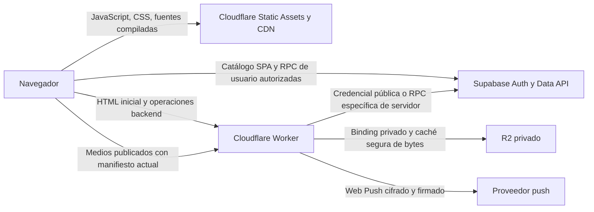

# Workers, Supabase y R2 — auditoría de recorridos y latencia

17 de noviembre de 2026. Trabajo exclusivamente en staging, sobre las
evidencias anteriores y nuevas mediciones. No se modificaron producción,
diseño, animaciones, precios, inventario, checkout, RLS ni Auth/MFA.

## Conclusión

Aroma Infini **ya utiliza una arquitectura híbrida**. No existe un proxy
genérico del catálogo que añada obligatoriamente un salto por Cloudflare:
las consultas SPA y la mayoría de operaciones administrativas van directamente
a las RPC autorizadas de Supabase. El Worker aporta lógica necesaria a la
entrega privada de medios, HTML inicial, cookies protegidas, subidas,
notificaciones push, operaciones de invitados y tareas programadas.

La latencia observada no corresponde principalmente a CPU del Worker.
La mediana de CPU de los eventos correlacionados fue de 3 ms en ambas
versiones; las esperas externas son mucho mayores. No se recomienda eliminar
Workers ni mover secretos o validaciones privilegiadas al navegador.

Se conservaron dos optimizaciones demostradas:

1. La caché existente de **bytes**, nunca de autorizaciones, también sirve SVG
   verificados y metadatos HEAD. Cada solicitud sigue consultando el manifiesto
   actual antes de acceder a esa caché. Se elimina un viaje a R2 en un HIT.
2. Las subidas comprueban Auth y `current_actor` en paralelo y esperan ambos
   resultados antes de reservar o escribir. Se mantienen las comprobaciones
   frescas inicial y final, identidad coincidente, MFA, errores y permisos.

## Mapa de operaciones: quién debe ejecutarlas

Las RPC no quedan protegidas únicamente por React: sus grants, funciones de
autorización, transacciones y RLS de las tablas subyacentes son imprescindibles.
RLS no se aplica directamente a funciones; los permisos EXECUTE y las
comprobaciones de cada función también forman parte de esa frontera.
[Seguridad de la Data API de Supabase](https://supabase.com/docs/guides/api/securing-your-api).

### Operaciones directas a Supabase: conservar

| Operación | Recorrido actual y decisión |
| --- | --- |
| Home | `catalog_home_context`, `catalog_brand_previews` y documento de Home por SDK; el HTML puede proporcionar sus DTO iniciales para no repetirlos al arrancar. |
| Tienda, filtros, búsqueda, orden y paginación | `catalog_browse` directo. No añadir un proxy Worker. |
| Ficha y recomendaciones | `catalog_product_context` directo en SPA; reutiliza el DTO inicial cuando viene del HTML. |
| Carrito y selección por identidades | `catalog_products_by_ids` por lotes acotados. |
| Cotización de checkout | `checkout_quote` directo; precios y disponibilidad los calcula SQL, no el navegador. |
| Perfil y direcciones | RPC por propietario; mantener permisos e identidad real. |
| Pedidos propios y favoritos | Consultas y comandos por propietario, sin caché compartida entre usuarios. |
| Reseñas y seguimiento | RPC públicas o de usuario con sus restricciones actuales. |
| Productos, inventario, pedidos y clientes del panel | RPC paginadas o por identidad; escrituras transaccionales y control de versión. No volver a descargar colecciones completas. |
| Marcas, familias, ofertas, cupones, tarifas y configuración | RPC administrativas con sesión comprobada y autorización SQL. |
| Importación Excel y selectores | Consultas específicas y comandos existentes; no enviar el catálogo completo a un Worker como paso intermedio. |
| Recuperación de cuenta y cambio de correo | Backend en Supabase Edge Functions, distinto de Cloudflare Workers; conservar la frontera privilegiada. |

Referencias: `remote-catalog-queries.ts`, `public-home-catalog.ts`,
`catalog-admin-service.ts`, `order-admin-service.ts`, `account-adapter.ts`,
`checkout-server.ts`, `commerce-settings-service.ts` y
`customer-favorites-service.ts` en `src/services/`.

### Inventario de endpoints y rutas Worker

| Ruta y método | Valor que aporta y decisión |
| --- | --- |
| `POST /api/admin/auth/device/register` | AAL2/TOTP, token aleatorio, hash y cookie HttpOnly/Secure/SameSite. **Necesita backend**. |
| `POST /api/admin/auth/device/resume` | Lee cookie protegida y vincula confianza a sesión verificada. **Necesita backend**. |
| `GET /api/admin/auth/devices` | Lista dispositivos con la misma frontera de autorización. Mantener; uso infrecuente y sin beneficio medido de trasladarlo. |
| `DELETE /api/admin/auth/devices/:uuid` | Revoca confianza y puede retirar la cookie actual. Mantener junto al protocolo. |
| `GET /api/admin/notifications` | Envuelve `admin_notifications`, pero también verifica Auth fresco, actor/MFA y limita abuso. Es intermediación parcial, no un proxy sin valor. No retirar esas protecciones. |
| `POST /api/admin/notifications/read` | Comando de usuario con igual autorización y límite. Mantener mientras no exista un sustituto equivalente de esas garantías. |
| `GET /api/admin/push/status` | Combina estado del dispositivo con la configuración efectiva y clave VAPID pública del servidor. Mantener. |
| `POST /api/admin/push/subscriptions` | Valida destinos y claves push, identidad y límites. Mantener. |
| `POST /api/admin/push/unsubscribe` | Coordina el protocolo push autorizado y sus límites. Mantener. |
| `POST /api/admin/push/test` | Firma y cifra push con secretos y despacha la cola. **Necesita backend**. |
| `POST /api/admin/media/upload` | Decodificación WebP completa, límites, reserva idempotente, R2 privado y confirmación verificada. **Necesita backend**. Se paralelizó la autorización independiente. |
| `POST /api/admin/media/video-upload` | Inspección MP4, integridad, límites y confirmación de almacenamiento. **Necesita backend**. |
| `POST /api/admin/media/svg-upload` | Inspección SVG estático y confirmación de bytes. **Necesita backend**. |
| `POST /api/checkout/simulate` | Identidad de invitados/usuarios, origen, límites y RPC comercial privilegiada transaccional. Mantener; cobros reales siguen desactivados. |
| `POST /api/complaints` | Admisión de invitados, validación, antispam, HMAC y RPC privilegiada. **Necesita backend**. |
| `GET/HEAD /media/public/dynamic/:uuid/:hash/:width.webp` | Manifiesto fresco y variante exacta; después caché de bytes o binding R2. Necesario bajo la política privada actual. |
| `GET/HEAD .../vector.svg` | Igual frontera; CSP, tamaño y tipo verificados. Ahora reutiliza bytes inmutables en HIT. |
| `GET/HEAD .../video.mp4` | Manifiesto y semántica Range/If-Range/ETag. Mantener; no se cambió esta ruta. |
| `/images/*`, `/videos/*`, `/brand/*` registrados | `builtin_media_resolve` y redirección sin caché, o 410/503. Protegen la retirada de originales. Las rutas técnicas no registradas conservan ASSETS. |
| HTML de Home, Tienda y fichas | SEO, 404/503, precargas responsive y DTO inicial público para evitar otra lectura desde React. Aporta procesamiento real. |
| HTML de páginas informativas | Documento multimedia/configuración pública y políticas SEO; no se cargan colecciones administrativas. |
| `/marcas/:slug` y `/tienda?marca=slug` | Metadatos de marca y proyección inicial. Duplicación parcial identificada abajo; no se eliminó SEO para acelerar artificialmente. |
| `/robots.txt`, `/sitemap.xml`, `/sitemap-*.xml` | Publicación autorizada y shards acotados. En staging no se publica el catálogo para indexación. |
| `/catalogo` | Redirección 308, sin viaje a Supabase. Coste trivial. |
| `/assets/*`, fuentes, JS y CSS compilados | Static Assets/CDN, fuera de `run_worker_first`. No atraviesan el handler de catálogo cuando existe el archivo. |
| Cron | Push y expiración de reservas en paralelo; limpieza multimedia acotada cada cinco minutos. **Necesita backend** y no bloquea una navegación del comprador. |

No hay un endpoint operativo de Mercado Pago ni webhook de pago real que
pueda darse por implementado. Cuando se conecten, firma, verificación e
idempotencia deberán permanecer en backend.

## Mediciones de infraestructura

Base: `da5735f3-23b6-45d6-af27-09459bd3c7fa`.
Candidata: `6f60dacd-5762-4480-9815-1be08fc110f9`.
Ambas se compararon en el mismo origen de staging mediante selección explícita
de versión, sin publicar el bucket ni alterar los datos comerciales.

Primero se hicieron 81 lecturas por versión: 50 recursos multimedia, documentos
y RPC anónimas directas. Después se realizaron **50 pares AB/BA contemporáneos**
(100 respuestas) de los mismos recursos. Peticiones seriales moderadas, sin
cache busting, sin subidas, sin pagos. La comparación alternada evita confundir
la mejora con un único período favorable de red. Todos los pares mantuvieron
los mismos bytes, ETag y Content-Type.

### Comparación multimedia alternada

Milisegundos; percentil de rango más próximo. La caché de navegador no participa
en estas peticiones HTTP; la caché de bytes del edge estaba caliente.

| Recurso | Pares | Cabeceras P50 antes → después | P95 antes → después | Cuerpo P50 antes → después | Manifiesto P50 antes → después | Almacenamiento P50 antes → después |
| --- | ---: | ---: | ---: | ---: | ---: | ---: |
| SVG del logo | 10 | 341,0 → 166,8 | 679,6 → 247,5 | 0,5 → 0,5 | 84 → 80 | 174 → 8 |
| WebP HEAD | 10 | 340,8 → 222,7 | 473,5 → 259,6 | 0 → 0 | 81 → 76 | 161 → 7 |
| WebP GET | 30 | 177,8 → 164,5 | 271,7 → 250,3 | 10,8 → 10,7 | 83 → 79 | 7 → 7 |

La mejora estructural es **retirar una lectura de R2 en los HIT de SVG y HEAD**.
Sus medianas de cabeceras bajan aproximadamente 51 % y 35 %. El WebP GET ya
tenía HIT en ambos brazos; sus 13 ms de diferencia no se atribuyen a una nueva
optimización. La caché no garantiza HIT en otro centro de datos o primera visita.

Se conserva el MISS inicial del SVG en la serie no alternada: 9 HIT de 10;
el resto siguió la ruta R2 normal. En los pares calientes, los 10 SVG y los
10 HEAD de la candidata fueron HIT. Los condicionales If-None-Match y los
vídeos siguen su recorrido anterior; no se almacenan respuestas 304 ni rangos.

### CPU, esperas externas y correlación

El tail conserva únicamente eventos públicos correlacionados con los IDs de
la sonda, descartando en memoria cookies, cabeceras privadas y solicitudes
ajenas. No se capturaron todos los eventos del proveedor:

| Medida | Base | Candidata |
| --- | ---: | ---: |
| IDs correlacionados / IDs solicitados | 32 / 91 | 39 / 91 |
| Eventos Worker con CPU/wall disponibles | 25 | 30 |
| CPU P50 / P95 | 3 / 14 ms | 3 / 16 ms |
| Wall P50 / P95 | 246 / 423 ms | 127 / 629 ms |

La mezcla de eventos no es idéntica; estos wall percentiles **no constituyen
un benchmark pareado de CPU**. El P95 peor no se oculta. Los IDs, versiones y
duraciones completos están en `baseline-tail.json` y `candidate-tail.json`.

En los pares, Envoy declara aproximadamente 2–3 ms de upstream mediano para
el manifiesto, mientras el intervalo HTTP visto por Worker ronda 76–84 ms.
Ese resto no es CPU de PostgreSQL: incluye tramos de transporte, gateway y
procesamiento no desglosados por la telemetría disponible.

También siguen ocurriendo respuestas lentas: un manifiesto tardó 614 ms hasta
cabeceras con 540 ms declarados por Envoy; otro, 620/547 ms. El primero tiene
ID cliente `1a0d4adf-2906-480a-bbc5-ee143dfd6766` y request upstream
`01a1ecec-7c48-7ece-94f6-5c844ed9d314`. No se atribuye ese tiempo a una consulta
SQL, pool de conexiones o servicio interno concreto sin spans que lo prueben.
Los cuerpos medidos fueron prácticamente inmediatos: la espera principal
precedía a las cabeceras.

Las 12 RPC anónimas directas por brazo confirman acceso sin proxy, pero no son
un sustituto equivalente de una descarga multimedia: entregan JSON, no bytes
de un objeto privado. Comparar sus tiempos brutos como si reemplazaran la
descarga sería una conclusión incorrecta.

### Subidas: evidencia estructural, no medición alojada

Modelo local con 30 ms controlados por comprobación Auth/actor y doce subidas
por versión: P50 **159,8 → 95,6 ms**, P95 **186,4 → 109,9 ms**.
La concurrencia de comprobaciones pasó de una a dos. Ambas versiones hicieron
24 lecturas Auth y 24 lecturas `current_actor`: no se cacheó ni eliminó ninguna.

Las pruebas con compuertas verifican que ninguna reserva o escritura ocurre
mientras falta un resultado; un fallo Auth conserva su error y espera también
la finalización de la otra lectura. La revocación durante una subida sigue
siendo rechazada antes de confirmar el activo.

No se hicieron subidas comerciales alojadas para producir un número de
rendimiento administrativo. La mejora de la dependencia secuencial está
demostrada localmente; el ahorro concreto en una sesión administrativa real
queda por medir, no se extrapola el número anterior a producción.

## Chrome, escritorio y móvil lento

120 visitas reales seriales en staging: Home, Tienda y ficha; cinco muestras
por brazo/ruta/perfil/estado de caché, AB/BA. Procesos nuevos por pareja
fría/caliente. Escritorio 1440 × 900; móvil 390 × 844, DPR 2, CPU ×4,
1,6 Mbps y 150 ms de latencia emulada. No se ejecutaron builds o suites pesadas
simultáneamente. No equivale a teléfonos físicos ni a INP de campo.

LCP mediano en milisegundos, incluyendo las muestras lentas:

| Perfil y página | Frío antes → después | Caliente antes → después |
| --- | ---: | ---: |
| Escritorio Home | 828 → 648 | 308 → 308 |
| Escritorio Tienda | 476 → 484 | 240 → 240 |
| Escritorio ficha | 672 → 716 | 284 → 284 |
| Móvil lento Home | 3.084 → 3.044 | 692 → 692 |
| Móvil lento Tienda | 2.608 → 2.632 | 564 → 556 |
| Móvil lento ficha | 2.832 → 2.824 | 600 → 588 |

**No hay una mejora general de LCP demostrada.** El beneficio del logo o de
HEAD no equivale automáticamente al tiempo del elemento LCP. No se presenta
la diferencia favorable de Home de escritorio como un efecto causal probado.
El intervalo frío de renderizado y la descarga de los demás recursos continúan
dominando el móvil lento; no se alteraron diseño o calidad para cambiarlo.

CLS fue cero en las 120 visitas, sin overflow, imágenes principales rotas,
errores de página o transferencias críticas fallidas. El móvil no montó vídeos
ni solicitó MP4/WebM. Los 120 archivos JS/CSS son idénticos byte por byte entre
versiones; no hubo cambio de bundle ni de estilos. En móvil frío el TBT de
laboratorio fue Home 90 → 90 ms, Tienda 87 → 83 ms y ficha 83 → 83 ms: tampoco
demuestra una nueva reducción del trabajo JavaScript.

Solicitudes medianas en móvil: 26/16/17 por Home/Tienda/ficha en ambos brazos.
Las diferencias de transferencia fueron inferiores a 0,3 KiB en estas visitas,
compatibles con metadatos diagnósticos variables. No se declara una reducción
del número de solicitudes públicas ni del peso de las fotografías.

Los NetLogs conservan tres resoluciones DNS superiores a un segundo:
1.024 ms en Home base, 1.033 ms en Home candidata y 1.016 ms en ficha base.
Suceden antes de enviar la petición HTTP y, por tanto, antes de ejecutar el
Worker. No identifican por sí solos al operador que demoró una respuesta.
No se cambió DNS, HTTP/2, HTTP/3, VPN, proxy ni configuración de producción.

La comprobación SPA usando enlaces reales de React Router produjo cuatro
navegaciones sin nuevas solicitudes Document. Tienda solicitó directamente
`catalog_browse`; ficha, `catalog_product_context`; Contacto reutilizó los
metadatos ya disponibles. No hubo un endpoint `/api/catalog` intermedio.
Dos sondas exploratorias usaron primero un anchor nativo y luego un enlace
oculto: sus fallos fueron de selección del harness, no se modificó la web para
aprobarlos. La sonda final utiliza los enlaces visibles existentes.

## Duplicaciones y alternativas descartadas o pendientes

### Lista de marcas en una entrada filtrada

`catalog-seo.ts` consulta `catalog_brands` para los metadatos de
`/tienda?marca=slug` y `/marcas/:slug`. Después la proyección inicial ejecuta
`catalog_browse`, cuyo DTO también contiene marcas. Es duplicación de datos
reales, aunque las lecturas tienen responsabilidades diferentes.

No se sustituyó una por otra a ciegas: SEO tiene presupuesto de hasta 2 MiB y
10 s, mientras browse inicial está limitado a 1 MiB/1 s y permite fallback
independiente. Hacerlo obligatorio antes de las cabeceras podría empeorar TTFB
o convertir un fallo de catálogo en fallo SEO. No hay un experimento equivalente
alojado de esa sustitución en esta entrega, por lo que permanece documentada,
sin declarar eliminado ese viaje. Su optimización futura debe reutilizar una
proyección validada con fallback conservador y demostrar equivalencia de 404,
marcas inexistentes, filtros y tiempos, no simplemente retirar los metadatos.

### Notificaciones y estado push

La lectura de notificaciones podría ejecutarse como RPC directa, pero hoy el
Worker suma verificación Auth, actor y límite por administrador. El frontend
ya agrupa peticiones concurrentes y limita las renovaciones a 60 s. Trasladar
la llamada sin un límite equivalente cambiaría seguridad/comportamiento, y no
se demostró que domine la navegación general. No se añadió otra caché privada
ni se retiró una validación para mejorar artificialmente el tiempo.

El estado push además necesita la configuración VAPID efectiva del servidor;
no es una RPC reenviada sin procesamiento. Registro, prueba y envío push
continúan en backend.

### Manifiesto por imagen

Se sigue haciendo una lectura de `media_public_asset` por solicitud que llega
al servidor, incluso HEAD y condicionales. Eso preserva la publicación actual
y evita servir un activo retirado desde un HIT. No es una consulta comercial
de precios/stock, pero sí una decisión de autorización/publicación que no se
puede cachear indiscriminadamente.

Agrupar los manifiestos en el HTML no elimina por sí solo la verificación de
las descargas siguientes. Un ticket o manifiesto versionado cacheado necesita
definir expiración, revocación y fuentes de verdad; no se añadió una capa que
simplemente cambiase una autorización fresca por otra obsoleta.

### URLs originales

El resolver de `/images`, `/brand` y `/videos` conserva la retirada de recursos
predeterminados. Evitar que HTML/React emitan esos enlaces cuando ya conocen
su referencia canónica es preferible a quitar ese control. Las imágenes
observadas en la traza de catálogo se solicitaron en rutas `/media/public/dynamic/`,
sin el desvío original → 302. No se eliminó el fallback necesario para URLs
antiguas o referencias todavía utilizadas.

## R2 directo/CDN: decisión de arquitectura

Comprobación real: `aroma-infini-media-dev` mantiene `r2.dev` desactivado y no
tiene dominios personalizados. No se habilitó acceso público, no se creó un
bucket y no se copiaron o retiraron archivos comerciales.

| Alternativa | Ventajas | Frontera y decisión |
| --- | --- | --- |
| Navegador → Worker → R2 privado | Publicación fresca, controles de integridad, HEAD/Range y rutas estables. | Mantener ahora. HIT de bytes reduce R2, pero permanece el viaje del manifiesto. |
| Navegador → dominio de R2 del bucket actual | Podría evitar cómputo y verificación intermedia. | Rechazada: haría accesibles borradores/huérfanos y evitaría la frontera de publicación. |
| Híbrida: R2 privado + bucket separado de recursos publicados + CDN | Permitiría retirar el manifiesto de cada descarga pública. | Alternativa válida para un experimento posterior, no implementada ni declarada más rápida sin dominio y pruebas equivalentes. |

El acceso `r2.dev` está limitado y es de desarrollo. Las capacidades de caché,
acceso y protección de buckets públicos se configuran mediante dominio propio.
[Documentación oficial de R2](https://developers.cloudflare.com/r2/buckets/public-buckets/).

Un diseño seguro de publicación separada necesita, al menos:

- Copiar solo objetos verificados con referencia comercial activa después del
  commit correspondiente; nunca exponer todo el namespace privado.
- Registrar revisión, hash y estado de publicación, con operación idempotente
  y reconciliación de fallos entre SQL y almacenamiento.
- Resolver carreras entre publicar, reemplazar, reutilizar y retirar mediante
  las asociaciones y reclamaciones existentes, respetando las 24 horas de
  seguridad y una segunda comprobación de referencias.
- Definir purga/invalidación y su plazo verificable. Una URL inmutable ya
  cacheada en un navegador no se revoca instantáneamente, tampoco hoy.
- Integrar la copia publicada en auditoría y limpieza, manteniendo privados
  borradores, documentos, ficheros de usuarios y operaciones administrativas.
- Medir frío/caliente y coste desde un dominio real: `r2.dev` no sería una
  comparación equivalente con CDN. La menor cantidad de saltos no prueba por
  sí sola menor latencia de extremo a extremo.

Las URLs prefirmadas de subida tampoco resuelven esta lectura. Podrían descargar
trabajo del Worker para archivos grandes, pero necesitan área privada de
cuarentena, autorización acotada, expiración breve e inspección/confirmación
posterior antes de publicar. No se sustituyó la validación de píxeles/MP4/SVG
por confiar en extensión o Content-Type enviados por el navegador.

La ubicación del cómputo podría ensayarse cerca del backend regional; no se
cambió placement por intuición. Es un Worker mixto de HTML, caché, R2 y SQL,
por lo que beneficiar SQL también puede perjudicar cercanía al visitante o a
la caché. Requiere un ensayo completo, no deducirlo solo de una distancia.
[Placement oficial](https://developers.cloudflare.com/workers/configuration/placement/).

## Despliegue, seguridad y validaciones

| Comprobación | Resultado |
| --- | --- |
| Staging activo | `6f60dacd-5762-4480-9815-1be08fc110f9`, 100 %. |
| Despliegue final staging | `b3021a55-c05f-45a9-b57b-2a6ab01941a4`. |
| Manifest SHA-256 del frontend | `b4e370ea9698c89ee242b401bfca6e0c0a2798d890524e55c46241223d4c1ff9`. |
| Worker JS alojado SHA-256 | `908d6ad9755138c96b37ac0bbd88108fc669cfff54ea26c53a2f4e5cafd16645`. |
| Código Worker alojado | El source map del módulo activo contiene exactamente el `media-handler.ts` local probado, normalizando CRLF. |
| JS/CSS públicos alojados | 120 hashes contrastados con el paquete; iguales a la base. |
| Bindings | Entorno staging, Supabase de desarrollo y bucket privado correctos. |
| Supabase | 44 migraciones, ninguna pendiente; hashes históricos coinciden. Esquema y datos comerciales iguales antes/después. No hubo migraciones nuevas. |
| TypeScript, ESLint, build y dry-run | Aprobados. |
| Contratos Worker/medios/comercio/push/SEO | 337 ejecuciones aprobadas. |
| Node | 215 pruebas aprobadas. |
| Navegador de fotografías y configuración multimedia | 26 pruebas aprobadas, incluidas laptop, tablet y móvil. |
| Recursos reales | 50 lecturas multimedia por versión y 50 pares adicionales con igualdad de bytes/ETag. |
| Navegador alojado | 120 visitas AB/BA, cero CLS y errores críticos; sin vídeos en móvil. |
| Límites HTTP alojados | Diez rutas protegidas deniegan sesiones ausentes, origen ajeno, métodos no permitidos y namespace interno. |
| Producción | Despliegue `9baa7c50-262a-4f23-bf52-5742a52ffa0b`, versión `ec8554f6-d47a-4af0-ba60-4623c8125020`, intactos. |

Las primeras pruebas detectaron dos aserciones que suponían cero RPC cuando
Auth devolvía un cuerpo excesivo. Con las lecturas paralelas se admite únicamente
`current_actor`, de solo lectura; las pruebas ahora exigen explícitamente cero
reservas y cero escrituras y conservan el rechazo y la cancelación del cuerpo.
También se corrigió el tipado del decoder ficticio de la nueva prueba SVG.
No se aumentaron plazos, reintentos ni se omitieron pruebas.

Los eventos CPU/wall no sustituyen un perfil pprof de funciones. No se capturó
un perfil de asignaciones o heap en esta entrega: no había evidencia de un
cuello dominante de CPU/GC que justificase otra refactorización. Se usó la
telemetría real por solicitud para separar CPU de espera externa, además de
las trazas de Chrome y los timings de gateway disponibles.

## Pendientes y límites

- Persisten variaciones de upstream del proveedor y resolución DNS. Faltan
  spans internos por request para distinguir pool, conexión, PostgREST o SQL;
  el documento de soporte anterior sigue siendo aplicable.
- No se ha demostrado un LCP frío general inferior a 2,5 s en móvil lento.
  La mejora de SVG/HEAD no se presenta como solución a todo el frontend.
- No se certificó latencia de subidas administrativas alojadas; la comparación
  de autorización es un modelo local con pruebas de seguridad y concurrencia.
- La reutilización SEO/browse de marcas y un CDN de publicación separada
  requieren experimentos específicos y equivalencia de seguridad. No se
  simularon resultados ni se modificó el bucket para fabricar la comparación.
- No se hicieron commits, push, compras, pagos ni cambios en producción.

Evidencias reproducibles: `artifacts/worker-path-audit-2026-11-17/`:
`media-paired.json`, `baseline-http.json`, `candidate-http.json`, sus tails,
`public-paired-final.json`, trazas, NetLogs, capturas, `spa-readonly.json`,
`summary.json`, `verification.json`, `worker-content.json`, comprobaciones de
esquema, logs de pruebas y hashes de preservación del trabajo.
